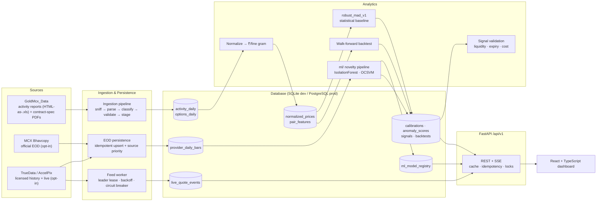

<div align="center">

# MCX Gold Intelligence — *Gold Insight*

### **Same Gold. Different Opportunities.**

Contract-aware relative-value analytics, novelty detection and cost-aware validation across the four MCX gold futures contracts: **GOLDM · GOLDTEN · GOLDGUINEA · GOLDPETAL**.

**Team Code Paradox · Hack in Hills '26 · Problem Statement PS-03 — Commodity Derivatives Intelligence**
Live Demo- https://mcx-gold.vercel.app/
</div>

---

## Table of Contents

1. [Overview (TL;DR)](#1-overview-tldr)
2. [Quick Start](#2-quick-start)
3. [Key Features](#3-key-features)
4. [The Problem](#4-the-problem)
5. [System Architecture](#5-system-architecture)
6. [Data Model & Data-Status Semantics](#6-data-model--data-status-semantics)
7. [Contract Specifications & Normalization](#7-contract-specifications--normalization)
8. [Analytics & Machine Learning](#8-analytics--machine-learning)
9. [Repository Structure](#9-repository-structure)
10. [Tech Stack](#10-tech-stack)
11. [Installation & Setup (Detailed)](#11-installation--setup-detailed)
12. [Configuration Reference](#12-configuration-reference)
13. [API Reference](#13-api-reference)
14. [Frontend Guide](#14-frontend-guide)
15. [Market-Data Providers & Live Feed](#15-market-data-providers--live-feed)
16. [Database & Migrations](#16-database--migrations)
17. [Reliability & Concurrency Infrastructure](#17-reliability--concurrency-infrastructure)
18. [Testing](#18-testing)
19. [Security & Compliance Notes](#19-security--compliance-notes)
20. [Operations Runbook](#20-operations-runbook)
21. [Known Limitations](#21-known-limitations)
22. [Roadmap](#22-roadmap)
23. [Market Context & Business Model](#23-market-context--business-model)
24. [Team & Acknowledgements](#24-team--acknowledgements)
25. [Disclaimer](#25-disclaimer)

---

## 1. Overview (TL;DR)

Raw MCX closing prices for gold contracts are **not apples-to-apples**. GOLDM, GOLDTEN, GOLDGUINEA and GOLDPETAL differ in trading unit, quotation basis, purity (995 vs 999) and expiry, so a naive price comparison manufactures false "spreads".

**MCX Gold Intelligence** fixes this end-to-end:

| Stage | What happens |
|---|---|
| **1. Collect** | Official MCX bhavcopy, licensed providers (TrueData / AccelPix) and supplied MCX activity reports. |
| **2. Normalize** | Every quote is converted to **₹ per fine gram** using effective-dated, document-verified contract specs. |
| **3. Detect** | Pairwise relative spreads are scored by a **robust-MAD baseline** and a **trained novelty model** (Isolation Forest / One-Class SVM). |
| **4. Validate** | Signals pass liquidity, expiry, cost and data-quality checks. A statistical anomaly is *not* automatically a trade. |
| **5. Explain** | A React dashboard shows signals with reason codes, feature values, lineage, walk-forward backtests and educational context. |

**Design philosophy:** *nothing is fabricated.* When data, credentials or a trained model are missing, the system says so (`NO_DATA`, `NOT_CONFIGURED`, `ML_MODEL_NOT_READY`) instead of inventing values. Every derived value carries a data status (`VERIFIED` / `PROVISIONAL`), and anomaly scores are explicitly *screening heuristics — not probabilities of profit and not investment advice.*

---

## 2. Quick Start

```bash
# 1) Backend (from repo root)
cd backend
python -m venv .venv && source .venv/bin/activate        # Windows: .venv\Scripts\activate
pip install fastapi "uvicorn[standard]" sqlalchemy alembic pydantic-settings \
            httpx pandas openpyxl xlrd pypdf scikit-learn numpy joblib \
            redis "psycopg[binary]" websockets pytest
uvicorn app.main:app --reload --port 8000                # SQLite auto-bootstraps in development

# 2) Frontend (new terminal, from repo root)
npm install
npm run dev                                              # http://localhost:5173  (proxies /api → :8000)

# 3) (Optional) Load the supplied MCX activity corpus  — expects ../GoldMcx_Data beside backend/
cd backend && python scripts/import_sources.py

# 4) (Optional) Train the ML novelty model — from repo root
python -m ml.train_model --sync-history --mode daily
```

Open **http://localhost:5173**. With an empty database every page renders an honest empty state; interactive API docs are at **http://localhost:8000/docs**.

> The Python package list above is derived from the codebase imports; pin versions in your own `requirements.txt` for reproducible builds.

---

## 3. Key Features

- **Contract-aware normalization** — effective-dated specs (trading unit, quote basis, purity) sourced from official MCX contract PDFs; every normalized value links to the spec version that produced it.
- **Six canonical pair analytics** — normalized spreads, price ratios, change features and volume/value context for every GOLDM/GOLDTEN/GOLDGUINEA/GOLDPETAL pairing.
- **Two complementary detectors**
  - `robust_mad_v1` — deterministic median/MAD novelty baseline with strict temporal isolation.
  - `mldaily_v1` — sklearn Isolation Forest / One-Class SVM trained on expiry-aware, roll-aware features, registered with checksum + lineage.
- **Signal validation pipeline** — separate *classification* (ANOMALOUS / NORMAL) from *disposition* (ACTIONABLE / WATCH / IGNORE) with liquidity, expiry, cost and data-quality checks and reason codes.
- **Walk-forward backtesting** — no look-ahead (calibration ends the day *before* each entry), configurable cost + slippage, gross-vs-net reporting, reproducible data-snapshot hash.
- **Robust ingestion** — content-sniffing (extensions are never trusted), HTML-as-`.xls` parsing, row-level validation with quarantine reasons, idempotent re-imports, source-file immutability verification.
- **Live-feed worker (opt-in)** — leader-elected provider worker, bounded reconnect with jitter, circuit breaker on auth/entitlement failures, deterministic de-duplication, SSE fan-out.
- **Production-grade plumbing** — `Idempotency-Key` handling, ordered advisory locking, epoch-invalidated cache (Redis or bounded in-process), structured JSON logs, consistent error envelopes.
- **Explainable UI** — signal drawer with feature values, reason codes, execution-quality checks, warnings and an explicit "what this does not imply" disclaimer.

---

## 4. The Problem

| # | Theme | Why naive comparison fails |
|---|---|---|
| 1 | **Contract mechanics** | Different trading units, quotation bases, purity (995/999) and expiry characteristics — direct price comparison manufactures a false spread. |
| 2 | **Term structure** | Different expiry windows create natural basis and roll-down effects; carry/storage/financing matter; continuous "near-month" stitching creates artificial jumps. |
| 3 | **Execution reality** | Settlement price is not a guaranteed fill; volume is not market depth; spreads widen near expiry; gross paper alpha can vanish after slippage and liquidity costs. |

**Theme alignment:** Public MCX data product · Rigorous analytics · Walk-forward validation · Cost-aware intelligence.

---

## 5. System Architecture



### Two data paths — never mixed

| Path | Input | Granularity | Status label | Used by |
|---|---|---|---|---|
| **Activity-implied** | Supplied MCX *DateWise activity reports* (lots + traded value) | Symbol-day aggregate, **no expiry dimension** | `PROVISIONAL` | Dashboard, comparisons, `robust_mad_v1`, backtests |
| **Provider / EOD** | Official bhavcopy, TrueData, AccelPix expiry-specific OHLC bars | Contract-expiry-day | `VERIFIED` / `PROVISIONAL` per source | `ml/` feature pipeline and trained model |
| **Live quotes** | Licensed provider stream | Tick / snapshot | `VERIFIED` / `RECEIVE_DERIVED_TIME` | SSE stream, contract cards |

Activity-implied values are **never** relabelled as provider data, and provider data is never relabelled as activity-derived.

---

## 6. Data Model & Data-Status Semantics

### Data-status vocabulary

| Status | Meaning |
|---|---|
| `VERIFIED` | Sourced from an official/authorised channel with full lineage (e.g. specs from official PDFs; bhavcopy-vs-bhavcopy ML pairs). |
| `PROVISIONAL` | Derived or activity-implied; computable but never presented as verified or as settlement data. |
| `NO_DATA` | Explicit empty-state response (HTTP 200) — never an error, never fabricated. |
| `QUARANTINED` | Row/bar failed validation and is excluded (with a recorded reason). |
| `RECEIVE_DERIVED_TIME` | Live event had no provider timestamp; receive time used and flagged. |

### Live-quote freshness
`age > LIVE_FEED_STALE_AFTER_S` → `STALE` · `age > stale/2` → `DELAYED` · otherwise `VERIFIED`. Provider states: `NOT_CONFIGURED`, `ENTITLEMENT_REQUIRED`, `DISCONNECTED`, `UNAVAILABLE`.

### Canonical pairs
Six canonical pair IDs (use these exactly): `GOLDM-GOLDTEN`, `GOLDM-GOLDGUINEA`, `GOLDM-GOLDPETAL`, `GOLDTEN-GOLDGUINEA`, `GOLDTEN-GOLDPETAL`, `GOLDGUINEA-GOLDPETAL`. A legacy frontend alias `REST-GOLDPETAL` maps to `GOLDGUINEA-GOLDPETAL`.

### Core tables

| Group | Tables |
|---|---|
| **Source registry** | `source_files`, `ingestion_runs`, `raw_source_rows` |
| **Market (activity path)** | `activity_daily`, `options_daily`, `gold_market_bars` (GOLD context series), `futures_bars` (reserved for real OHLC) |
| **Specs & derived** | `contract_specs`, `normalized_prices`, `pair_features` |
| **Scoring & signals** | `model_calibrations`, `anomaly_scores`, `signals`, `backtest_runs`, `backtest_metrics` |
| **Live / provider** | `provider_instruments`, `provider_daily_bars`, `live_quote_events`, `provider_sessions` |
| **ML registry** | `ml_model_registry` |
| **Infrastructure** | `api_idempotency` |

Natural-key unique constraints guard every ingestion/derivation table, making re-runs idempotent.

---

## 7. Contract Specifications & Normalization

### Verified specification master (effective-dated)

| Symbol | Trading unit | Quote basis | Purity | Effective from | Source document |
|---|---|---|---|---|---|
| **GOLDM** | 100 g | per 10 g | 995 | 2026-05-01 | `gold-mini-may-2026-contract-onwards.pdf` |
| **GOLDTEN** | 10 g | per 10 g | 999 | 2025-04-01 | `gold-ten-april-2025-contract-onwards….pdf` |
| **GOLDGUINEA** | 8 g | per 8 g | 999 | 2026-07-01 (DDR-based final settlement) | `gold-guinea-july-2026-contract-onwards.pdf` |
| GOLDGUINEA | 8 g | per 8 g | 999 | 2025-12-01 → 2026-06-30 (3-day staggered tender) | `gold-guinea-december-2025-contract-onwards….pdf` |
| GOLDGUINEA | 8 g | per 8 g | 999 | 2025-01-01 → 2025-11-30 (5-day staggered tender) | `gold-guinea-january-2025-contract-onwards….pdf` |
| **GOLDPETAL** | 1 g | per 1 g | 999 | 2025-04-01 | `gold-petal-april-2025-contracts-onwards….pdf` |

Dates with no verified spec fall back to the latest known spec and are never labelled `VERIFIED`.

### Normalization formulas

```text
fine_grams_per_quote = quote_grams × purity_per_mille / 1000
price_per_quote      = quoted_price × quote_grams / trading_unit_grams
normalized_value     = price_per_quote / fine_grams_per_quote        # ₹ per fine gram

# Provider/EOD path (close quoted per quote_grams):
value_per_fine_gram  = close / (quote_grams × purity_per_mille / 1000)
  e.g. GOLDM ₹1,51,000 per 10 g @ 995  →  151000 / 9.95 = ₹15,175.88 / fine g

# Activity-implied path (PROVISIONAL):
value_per_lot        = total_value_lakhs × 100000 / lots

# Pairwise relative spread (dimensionless, %):
spread_pct = (A − B) / ((A + B) / 2) × 100
```

Only the `standard_fine` quote rule is implemented; any other rule must be added as an explicitly verified contract-specific transform (never silently generic).

---

## 8. Analytics & Machine Learning

### 8.1 Statistical baseline — `robust_mad_v1`

| Element | Definition |
|---|---|
| Centre | median of training spreads |
| Scale | MAD → fallback IQR/1.349 → fallback floor `max(|median|×0.01, 1e-4)` |
| Robust z | `0.6745 × (x − median) / scale` |
| Score | `min(|z| / 6, 1)` — *a heuristic, not a probability* |
| Anomaly rule | `|z| ≥ 3.5` (configurable 1–99) |
| Severity | `Normal` · `Watch` (≥ threshold) · `High` (≥ threshold + 1) |

**Temporal isolation guarantees**
- Calibration uses observations in `[train_start, train_end)` — the boundary day itself is excluded.
- Minimum **10** training observations; calibrations are **pair-specific** (no cross-pair pooling).
- Scoring a date that belongs to its own calibration sample is rejected.
- Results are deterministic and carry algorithm + feature versions.

### 8.2 Signal validation (classification ≠ disposition)

| Stage | Result values | Notes |
|---|---|---|
| `data_quality` | `PASS_WITH_CAVEATS` | Activity-implied spreads are scorable but never verified. |
| `expiry` | `UNSCORABLE` | The activity corpus has no expiry dates → days-to-expiry unavailable. |
| `liquidity` | `PASS` / `WARN` (<1,000 combined lots) / `FAIL` / `UNSCORABLE` | Activity totals are not market depth. |
| `costs` | `PASS_WITH_ASSUMPTIONS` | Config-driven; no bid/ask or fill data. |
| `convergence` | `NOT_EVALUATED` | Assessed only inside backtests, never as a live guarantee. |

Output: `status` (`ANOMALOUS`/`NORMAL`), `disposition` (`WATCH`/`IGNORE`/…), `reason_codes`, `checks`. On the activity-implied path a statistical anomaly resolves to **WATCH**, never `ACTIONABLE`, because expiry and execution quality cannot be verified.

### 8.3 Trained ML novelty model — `mldaily_v1`

**Feature schema (11 features, identical for training and inference)**

| Feature | Description |
|---|---|
| `spread_pct` | Normalized relative spread |
| `spread_change_pct` | Day-over-day change (suspended across contract rolls) |
| `log_ratio` | `ln(A/B)` of normalized values |
| `rolling_z_20` | Causal robust z over the previous 20 observations |
| `rolling_vol_20` | Causal MAD-based volatility proxy |
| `dte_left`, `dte_right`, `dte_diff` | Real days-to-expiry per leg and their difference |
| `log_volume_ratio` | `ln(volL/volR)` when both volumes exist |
| `volume_missing` | Flag for absent volume |
| `is_roll_boundary_last` | Flag when either leg's front contract changed |

**Feature-engineering rules:** strictly causal windows (day *t* never feeds its own window); roll-aware front-contract selection by nearest unexpired expiry; same-`trade_date` inner join with **no forward-fill**; observations carry real leg expiries; gaps >7 days flagged `significant_calendar_gap`.

**Training pipeline**

1. Collect authorised history → `provider_daily_bars` (idempotent, priority-reconciled).
2. Build validated pair dataset — fails loudly (`TrainDataError`) below **60** observations per pair or **300** total.
3. Presumed-normal partition: exclude rows with causal `|rolling_z_20| > 3.5`; require ≥ 60 kept rows.
4. Candidate evaluation via **chronological walk-forward** (60% initial train, rolling blocks, never shuffled): `IsolationForest` (300 trees, contamination 0.04, `random_state=42`) vs `OneClassSVM` (RBF, `nu=0.12`). One-Class SVM is selected only if its score stability beats Isolation Forest by ≥20%; otherwise Isolation Forest.
5. Pipeline = `RobustScaler` → estimator, fit **only** on the training partition. Threshold = `(1 − contamination)` quantile of training inlier scores. Severity `High` at ≥ 1.3 × threshold.
6. Save bundle atomically (tmp file + `fsync` + `os.replace`), compute SHA-256, register in `ml_model_registry` (`candidate → active → retired | failed`), write a JSON report to `ml/reports/`.

**Inference safety:** the artifact path comes only from trusted DB metadata and must resolve under `ML_ARTIFACT_DIR` (no traversal); SHA-256, bundle version, feature schema and scikit-learn major.minor are re-verified at load. Any mismatch raises `ModelUnavailable` and scoring stops — the system never silently degrades to the baseline while pretending it is the ML model.

**Evaluation honesty:** no ground-truth labels exist, so **no precision/recall/profitability claims** are made. Reported: walk-forward score stability, holdout alert rate, and rate agreement with the robust-MAD baseline.

### 8.4 Idempotent daily job (`python -m ml.jobs`)

`sync authorised EOD sources → rebuild dataset (same feature code) → score new observations with the ACTIVE artifact only → persist AnomalyScore + SignalEvaluation → bump cache after commit`

Honest terminal states: `completed`, `completed_no_scoring` (data insufficient **or** `ML_MODEL_NOT_READY`). Re-runs skip already-scored `(pair, date, model_version, frequency)` tuples. Each run is recorded durably in `ingestion_runs` with `mode = daily_ml_job`.

### 8.5 Walk-forward backtest — `spread_mean_revert_v1`

| Aspect | Rule |
|---|---|
| Minimum data | 30 observations in window |
| Entry | `|z| ≥ threshold` vs a calibration whose `train_end` = entry day (no look-ahead) |
| Direction | Bet on convergence to the calibration median |
| Exit | Spread crosses median (convergence), or cost-stop at `−2 × |entry z|` |
| Costs | `cost_bps_per_leg` (default 4) + `slippage_bps_per_leg` (default 2), applied round-trip |
| Metrics | `trades`, `hit_rate`, `gross_return_pct`, `net_return_pct`, `cost_drag_pct`, `benchmark_move_pct` (common-movement proxy), data-status flag |
| Reproducibility | `data_snapshot` SHA-256 of the exact feature series; deterministic runs |

Results are strategy-relative screening evidence on PROVISIONAL data — **not** proven profitability.

---

## 9. Repository Structure

```text
.
├── backend/
│   ├── alembic/                  # Migration env + 3 versioned migrations
│   ├── app/
│   │   ├── analytics/            # normalize.py (specs), features.py (pair features), signals.py
│   │   ├── anomaly/              # baseline.py (robust_mad_v1), service.py (calibrate/score)
│   │   ├── api/v1/routes/        # backtests, comparisons, contracts, dashboard, events,
│   │   │                         # health, ingestion, market_live, ml_ops, model, signals
│   │   ├── backtesting/          # walkforward.py
│   │   ├── core/                 # config, errors, idempotency, logging, pairs
│   │   ├── db/                   # base, session, migrations (dev bootstrap), locking
│   │   ├── ingestion/            # sniffing, parsers, classification, discovery, pipeline
│   │   ├── market/               # feed_worker.py (live provider worker + SSE store)
│   │   ├── models/               # SQLAlchemy models (market, evaluation, live, source, request, ml_registry)
│   │   ├── providers/            # base, mcx_eod, truedata, accelpix
│   │   ├── schemas/              # Pydantic DTOs
│   │   ├── services/             # market_builder, eod_persistence, instrument_map
│   │   ├── cache.py              # Redis / bounded in-process cache facade
│   │   └── main.py               # FastAPI app factory
│   ├── scripts/import_sources.py # CLI: scan → import → market rebuild
│   └── tests/                    # pytest suite
├── ml/                           # Root-level ML package (training + inference + jobs)
│   ├── data_sources.py  dataset.py  features.py  train.py  evaluate.py
│   ├── inference.py     jobs.py     train_model.py
│   ├── artifacts/                # *.joblib bundles (generated, git-ignore recommended)
│   └── reports/                  # train_<version>.json (generated)
├── src/                          # React + TypeScript frontend
│   ├── components/  pages/  lib/  data/  styles/  types/
│   ├── App.tsx  main.tsx
├── dist/                         # Vite production build output
├── index.html  vite.config.ts  tailwind.config.js  postcss.config.js
```

---

## 10. Tech Stack

| Layer | Technology |
|---|---|
| **Frontend** | React · TypeScript · Vite · Tailwind CSS · Recharts · lucide-react |
| **Backend** | Python · FastAPI · Pydantic v2 / pydantic-settings · SQLAlchemy 2 · Alembic · httpx · websockets |
| **ML / Analytics** | scikit-learn (IsolationForest, OneClassSVM, RobustScaler) · NumPy · pandas · joblib |
| **Database** | SQLite (local dev) · PostgreSQL / Supabase (shared & production, `psycopg`) |
| **Cache** | Redis (optional) with bounded in-process fallback |
| **Data & APIs** | MCX official data/bhavcopy · TrueData Market Data API · AccelPix PIX API |
| **Parsing** | HTML-table parser, `xlrd` (legacy XLS), `pandas`/`openpyxl` (bhavcopy xlsx), `pypdf` |

---

## 11. Installation & Setup (Detailed)

### Prerequisites

- Python 3.11+ (3.10 minimum for `X | None` union syntax)
- Node.js 18+ and npm
- *(Optional)* PostgreSQL / Supabase, Redis
- *(Optional)* The `GoldMcx_Data` folder (MCX activity reports + contract-spec PDFs) placed **beside** `backend/`

### 11.1 Backend

```bash
cd backend
python -m venv .venv && source .venv/bin/activate
pip install <dependencies listed in Quick Start>
cp .env.example .env        # create/edit .env (see Configuration Reference)
uvicorn app.main:app --reload --port 8000
```

- **Development / test** (`APP_ENV=development`) with SQLite auto-creates all tables at startup (`ensure_schema`), including additive back-fill of late-added columns/constraints.
- **PostgreSQL** is always migrated with Alembic (see [§16](#16-database--migrations)). **Non-development environments refuse to start on SQLite.**
- Local writable storage (SQLite file, downloaded bhavcopy files) lives in `backend/storage/`.

### 11.2 Load the MCX activity corpus (activity-implied path)

```bash
cd backend
python scripts/import_sources.py            # idempotent: scan → import → derive market tables
python scripts/import_sources.py --reset    # drops backend tables first (never touches source files)
```

What it does: registers files by SHA-256 → detects format by **content signature** → classifies (`ACTIVITY_REPORT` / `OPTIONS` / `CONTRACT_SPEC` / `UNSUPPORTED`) → validates every row (quarantine with reasons) → upserts `activity_daily` / `options_daily` / `gold_market_bars` → seeds contract specs → derives `normalized_prices` and `pair_features` for all six pairs → verifies the source tree was **not modified**.

Expected layout: `GoldMcx_Data/<SYMBOL>/…DateWise… .xls` (top-level folder identifies the symbol; paths containing `summary` are treated as summary reports, others as detail). Contract-spec PDFs are registered for review and are never auto-authoritative.

Alternatively use the admin endpoints `POST /api/v1/ingestion/scan` and `POST /api/v1/ingestion/import` (see API Reference). Contract specs are seeded by the market-rebuild step, so run an import before ML feature building.

### 11.3 Frontend

```bash
npm install
npm run dev        # Vite dev server on :5173, proxies /api → http://127.0.0.1:8000
npm run build      # production bundle in dist/
```

Set `VITE_API_BASE_URL` to point at a remote API (only this public base URL is exposed to the browser — **no secrets in Vite env**). If unset, requests go same-origin / through the dev proxy.

### 11.4 Train the ML model

```bash
# from repo root
python -m ml.train_model --sync-history --mode daily     # collect + train + register
python -m ml.train_model --train-only                    # train from data already in DB
python -m ml.train_model --status                        # print registry status
python -m ml.train_model --sync-history --days 30        # wider history lookback
```

Exit codes: `0` success · `2` insufficient data · `3` insufficient presumed-normal rows · `4` artifact/registration failure · `5` intraday not supported. Intraday training is intentionally unavailable: EOD bars cannot train a tick-frequency model.

### 11.5 Schedule the daily job

```bash
python -m ml.jobs --days 10          # cron / Task Scheduler safe, safe to re-run
# or admin API: POST /api/v1/ml/jobs/daily-run
```

---

## 12. Configuration Reference

Settings load from environment variables / `.env` (via `pydantic-settings`, unknown keys ignored). **No secret is ever logged or exposed to the browser.**

### Core & database

| Variable | Default | Description |
|---|---|---|
| `APP_ENV` | `development` | `development` / `test` allow SQLite; others require PostgreSQL. |
| `API_PREFIX` | `/api/v1` | API mount prefix. |
| `DATABASE_URL` | `sqlite:///./storage/mcx_gold_dev.db` | Runtime DB. Use `postgresql+psycopg://…` for deployments. |
| `DATABASE_URL_OVERRIDE` | — | Env override (tests/CI) honoured by both app and Alembic. |
| `MIGRATION_DATABASE_URL` | — | Direct/session-capable URL for migrations (e.g. Supabase non-pooled). |
| `DB_POOL_SIZE` / `DB_POOL_MAX_OVERFLOW` / `DB_POOL_RECYCLE_S` | `5` / `5` / `1800` | Postgres pool tuning. |
| `DB_STATEMENT_TIMEOUT_MS` / `DB_LOCK_TIMEOUT_MS` / `DB_IDLE_IN_TRANSACTION_TIMEOUT_MS` | `15000` / `8000` / `30000` | Server-side session timeouts. |
| `REDIS_URL` | — | Enables the shared cache; unset → degraded bounded local cache. |
| `CORS_ORIGINS` | `http://localhost:5173,http://127.0.0.1:5173` | Comma-separated allowed origins. |
| `LOG_LEVEL` | `INFO` | Structured JSON logging level. |

### Source data

| Variable | Default | Description |
|---|---|---|
| `MCX_DATA_DIR` | `../GoldMcx_Data` | Read-only source corpus root (relative to `backend/`). |
| `DATA_WRITE_MODE` | `read_only` | Source root is never written to. |
| `IMPORT_MAX_FILE_MB` | `50` | Import size ceiling. |

### Market-data providers & live feed

| Variable | Default | Description |
|---|---|---|
| `MARKET_DATA_PROVIDER` | — | `truedata` \| `accelpix` \| `mcx_direct` (direct requires a separately licensed feed). |
| `LIVE_FEED_ENABLED` | `false` | Starts the in-process feed worker at app startup. |
| `PUBLIC_MARKET_DATA_DISPLAY` | `false` | **Licensing gate** for redistributing provider data publicly. |
| `TRUEDATA_LOGIN_ID` / `TRUEDATA_PASSWORD` | — | TrueData credentials. |
| `TRUEDATA_LIVE_URL` / `TRUEDATA_LIVE_PORT` | `push.truedata.in` / `8082` | Live websocket endpoint. |
| `TRUEDATA_AUTH_URL` / `TRUEDATA_HISTORY_URL` | `https://auth.truedata.in/token` / `https://history.truedata.in` | REST auth & history. |
| `ACCELPIX_API_KEY` | — | AccelPix `api_token`. |
| `ACCELPIX_API_HOST` / `ACCELPIX_SCHEME` | `apidata.accelpix.in` / `https` | AccelPix endpoint. |
| `MCX_EOD_ENABLED` | `false` | Enables official bhavcopy sync. |
| `MCX_BHAVCOPY_BASE` | `https://www.mcxindia.com/backup/bhavcopy/BhavCopy_MCX_` | Bhavcopy URL prefix. |
| `LIVE_FEED_STALE_AFTER_S` | `8` | Quote staleness threshold. |
| `LIVE_QUOTE_CACHE_TTL_S` | `2` | Poll/cache interval. |
| `MCX_SESSION_TZ` | `Asia/Kolkata` | Session timezone. |

### ML / frontend

| Variable | Default | Description |
|---|---|---|
| `ML_ARTIFACT_DIR` | `ml/artifacts/` | Trusted root for `.joblib` bundles. |
| `VITE_API_BASE_URL` | *(empty)* | Public API base URL for the browser. |

---

## 13. API Reference

Base URL: `http://localhost:8000` · Interactive docs: `/docs` · All JSON errors use a uniform envelope:

```json
{ "error": { "code": "not_found", "message": "Unknown symbol 'BOGUS'. Valid symbols: …" } }
```

Codes: `bad_request`, `invalid_input` (400), `not_found` (404), `unprocessable_data` (422), `conflict` (409), `service_unavailable` (503), `internal_error` (500, generic — no internals leaked).

### Health (service root)

| Method | Path | Purpose |
|---|---|---|
| GET | `/health/live` | Liveness — never touches the database. |
| GET | `/health/ready` | Readiness — checks database reachability. |

### Market analytics (`/api/v1`)

| Method | Path | Purpose |
|---|---|---|
| GET | `/contracts` | Contract inventory with specs, coverage and data summary. |
| GET | `/contracts/{symbol}` | One contract's detail. |
| GET | `/contracts/{symbol}/series` | Normalized ₹/fine-g series (`NO_DATA` → 200 with empty points). |
| GET | `/comparisons?pair=…` or `?left=&right=` | Pair spread series; filters `start`, `end`, `range_days`. |
| GET | `/dashboard/summary?limit=` | Contracts, data freshness, source quality, top anomalous signals. |
| GET | `/signals` | Filtered list (`pair`, `status`, `disposition`, `date_from`, `date_to`, `limit≤500`, `offset`). |
| GET | `/signals/{id}` | Full detail incl. calibration, checks, feature values. |
| GET | `/events` | Verified spec-change events (`category`, `date_from`, `date_to`). |

### Model (statistical baseline)

| Method | Path | Purpose |
|---|---|---|
| GET | `/model/pairs/{pair_id}/training-summary` | Latest calibration for a pair. |
| POST | `/model/pairs/{pair_id}/calibrate` | Create a calibration (`train_start`, `train_end`, `threshold`, `scale_floor_fraction`). *Idempotent.* |
| POST | `/model/pairs/{pair_id}/score` | Score `observation_date` (optional explicit `value`) and evaluate the signal. |

### Backtests

| Method | Path | Purpose |
|---|---|---|
| GET | `/backtests` | Stored runs (paged). |
| POST | `/backtests/run` | Run server-side walk-forward (`pair_id`, `start`, `end`, `threshold`, `cost_bps_per_leg`, `slippage_bps_per_leg`). *Idempotent.* |

### ML operations

| Method | Path | Purpose |
|---|---|---|
| GET | `/ml/status?mode=daily` | `READY` / `NOT_READY` / `UNAVAILABLE`, registry history, evaluation. |
| GET | `/ml/latest-anomalies?pair_id=&limit=` | Persisted model-scored observations (`NO_DATA` when empty). |
| GET | `/ml/anomalies/{score_id}` | Score + disposition detail. |
| GET | `/ml/jobs` | Recent daily-job run records. |
| POST | `/ml/jobs/daily-run` | **Admin** — run sync → features → scoring. *Idempotent.* |

### Ingestion (admin)

| Method | Path | Purpose |
|---|---|---|
| POST | `/ingestion/scan` | Walk the source root, record manifest. |
| POST | `/ingestion/import` | Parse, validate, stage, persist, rebuild derived tables. |
| GET | `/ingestion/runs/{run_id}` | Run status. |
| GET | `/ingestion/quality-report` | Class/format/status totals and rejection reasons. |

### Live market (`/api/v1/market`)

| Method | Path | Purpose |
|---|---|---|
| GET | `/live/status` | Provider state (no credentials), feed state, freshness per symbol, licensing gate. |
| GET | `/live/quotes?symbol=&since=` | Latest persisted quote per symbol. |
| GET | `/live/stream` | **SSE** stream; unconfigured deployments emit a single `NOT_CONFIGURED` status event and close. |
| POST | `/history/sync?days=` | **Admin** — official bhavcopy sync (requires `MCX_EOD_ENABLED`). |
| GET | `/history/{symbol}?days=` | Provider daily bars (`NOT_CONFIGURED` when credentials absent). |

### Idempotency

Mutating endpoints accept an `Idempotency-Key` header. First request atomically **claims** the key; an identical retry replays the stored response; the same key with a different body returns **409**; dead leases (> 600 s) are reclaimable so keys never wedge.

### Admin guard

Admin endpoints require the `x-admin-token` header outside `APP_ENV=development`. See [§19](#19-security--compliance-notes) for an important caveat.

---

## 14. Frontend Guide

**Principle:** the browser talks **only** to the FastAPI backend — never directly to Supabase or vendor APIs — and never trains, scores or fabricates data. API failures surface as explicit error/empty states (`useApi` has no fixture fallback).

| Page | Purpose |
|---|---|
| **Dashboard** | Hero, four contract cards (fresh-quote gated), normalized price trend, latest signals, contract details, compare widget, data freshness, "How it works". |
| **Signals** | Filterable/sortable table of model-scored observations (status, disposition, period, pair) with detail drawer. |
| **Contracts** | Per-contract overview, price chart, term-structure spreads, historical table, verified specifications. |
| **Comparison** | Pair selector (same-symbol blocked), price comparison, spread chart with robust band, relative value, correlation, latest scored observation. |
| **Model** | Active-model readiness, registry lifecycle, per-pair scored observations, job runs, admin "queue retrain". |
| **Backtest & Events** | Verified spec-change events and server-side walk-forward runs with gross/net metrics. |
| **Market Insights / Learn** | Static, clearly-labelled *illustrative* educational content (methodology, formulas, FAQ). |

**Design system:** warm maroon/gold palette via Tailwind tokens (`maroon`, `gold`, `warmwhite`, `appBg`), shared `Panel`, `Modal`, `StatusBadge`, `DataState`, `Sparkline`, `PriceComparisonChart`, `SpreadChart` components.

**Static vs live content:** `src/data/*` holds educational/illustrative content only (insights, learn FAQ, search index). Operational data is never sourced from it.

---

## 15. Market-Data Providers & Live Feed

| Provider | Capabilities | Auth | Notes |
|---|---|---|---|
| **MCX bhavcopy** | Official EOD, expiry-specific OHLC | None (opt-in via `MCX_EOD_ENABLED`) | Header-mapped parser (`bhavcopy_v1`), per-row quarantine, mismatched trade dates quarantined, options excluded. Highest reconciliation priority (100). |
| **TrueData** | REST EOD history + live websocket | Login id/password → bearer token | Single concurrent session per account; rate limits respected; priority 50. |
| **AccelPix** | REST quote snapshots + EOD history | `api_token` (URL-encoded, redacted in logs) | Master download with lot size; priority 50. |
| **mcx_direct** | Licensed direct feed | Dedicated credentials | Not implemented without licence — reports not configured. |

**Instrument mapping:** the feed never guesses tickers. Only `provider_instruments` rows with `verified = true` are subscribed. Master sync records *candidates* (unverified) pending operator verification against the contract spec.

**Feed worker guarantees:** refuses to start without credentials (`not_configured`) · single leader via PostgreSQL **session-level** advisory lock · bounded exponential backoff with jitter · circuit-breaker on `AUTH`/`ENTITLEMENT` errors · malformed events dropped without killing the stream · staleness enforced on event time (UTC) · deterministic SHA-256 de-duplication backed by `uq_live_quote_events_dedup` · bounded batch persistence (≤200).

**Reconciliation:** one record per `(symbol, expiry, trade_date)`; a higher-priority source overrides lower-priority data; a lower-priority source never overrides an official record; rows are never blended across providers.

---

## 16. Database & Migrations

```text
fbd044ec5500  mcx core tables
   └─ 9888119e04bc  live feed & idempotency tables
        └─ c9e86bc5b23f  ml_model_registry · live_quote_events dedup unique · anomaly_scores.model_version
```

```bash
cd backend
alembic upgrade head                                   # uses DATABASE_URL (or MIGRATION_DATABASE_URL)
alembic -x database_url_override=<url> upgrade head    # explicit scratch target
```

URL precedence: `-x database_url_override` → `DATABASE_URL_OVERRIDE` → `MIGRATION_DATABASE_URL` → settings. Migrations render in **batch mode** for SQLite compatibility. The third migration is intentionally a hand-written **delta**; the core schema is created only by `fbd044ec5500`.

**Supabase:** use a direct/session-capable URL for migrations and the transaction pooler (port 6543) for the app; prepared statements are auto-disabled in pooler mode and TLS is required by default.

---

## 17. Reliability & Concurrency Infrastructure

- **Advisory locking (`db/locking.py`)** — transaction-scoped `pg_try_advisory_xact_lock` with bounded wait (`LockTimeout`), a single global lock order (namespaces `source → dataset → pair → calibration → backtest → ingestion`, then identifier) and strict two-phase release at commit/rollback. SQLite tests use an equivalent in-process stub.
- **Cache (`cache.py`)** — keys embed endpoint + params + **dataset epoch**; epoch is bumped **only after a successful commit** (rolled-back writes never invalidate); TTL jitter prevents synchronized expiry; single-flight guard with bounded wait prevents stampedes. Default TTLs: dashboard 12 s · contracts 60 s · comparisons 20 s · signals 15 s · backtests 90 s · ingestion 30 s · live 2 s.
- **Idempotency** — see [§13](#idempotency).
- **Observability** — structured JSON logs (`ts`, `level`, `logger`, `message`, `request_id`/`run_id`), secrets never logged, query-string credentials redacted.
- **Source immutability** — SHA-256 manifest verified before and after each import.
- **Atomic artifact publication** — models written via temp-file + `os.replace`.

---

## 18. Testing

```bash
cd backend
pytest -q
```

Tests use in-memory/temp SQLite via `DATABASE_URL_OVERRIDE` and never write to the real corpus (a checksum-only immutability test reads it when present; set `MCX_DATA_DIR_ABS` to pin a CI root).

| Suite | Covers |
|---|---|
| `test_api.py` | Health, error schema, validation, alias equivalence, calibrate/score flow, signals, dashboard. |
| `test_baseline_and_service.py` | MAD / IQR / floor paths, threshold boundaries, determinism, calibration isolation, pair-specific calibrations. |
| `test_normalize.py` | Hand-calculated purity/quote-basis normalization, effective-dated spec selection. |
| `test_ingestion.py` | Content sniffing, HTML-as-xls parsing, row validation, quarantine reasons, idempotent import, source immutability. |
| `test_backtest.py` | Window rules, cost arithmetic (net = gross − drag), determinism, benchmark separation. |
| `test_market_persistence.py` | EOD upsert idempotency, source-priority reconciliation, quote de-duplication, DB-enforced uniqueness. |
| `test_infra_concurrency.py` | Idempotency claim/replay/conflict/lease takeover, lock ordering & bounded contention, cache epoch semantics. |
| `test_ml_roundtrip.py` | Train → register → load → score round trip, checksum & trusted-root gating, honest daily-job states. |
| `test_pairs.py` | Canonical pair contract, alias mapping, explicit unknown-id errors. |

---

## 19. Security & Compliance Notes

- **No secrets in the browser.** Only `VITE_API_BASE_URL` is read by Vite; provider credentials live exclusively in backend env.
- **Credential redaction** for `api_token`/`password` query values in logs; classified provider errors never carry credentials.
- **Read-only source corpus**; all writes go to backend-owned storage.
- **Safe artifact loading** — registry-sourced path only, trusted-root resolution, checksum and schema verification before `joblib.load`.
- **CORS** restricted to configured origins; methods limited to `GET`, `POST`, `OPTIONS`.
- **Licensing gate** — `PUBLIC_MARKET_DATA_DISPLAY` must remain `false` unless redistribution entitlement is recorded.
- **Official channels only** — no scraping of public MCX pages.
- ⚠️ **Admin guard caveat:** `_ensure_admin` currently accepts *any non-empty* `x-admin-token` value (or any request in `development`). Before exposing the API publicly, replace it with real token validation (e.g. a secret compared in constant time) and/or network-level protection.

---

## 20. Operations Runbook

| Symptom | Meaning | Action |
|---|---|---|
| Pages show "No scored signals yet" | No scored observations in DB | Import data → run the daily job (or calibrate + score pairs). |
| `ML_MODEL_NOT_READY` / `status: NOT_READY` | No active registered artifact | `python -m ml.train_model --sync-history --mode daily` |
| `status: UNAVAILABLE` + checksum / trusted-root note | Artifact validation failed | Retrain or restore the artifact; never edit registry paths manually. |
| `TrainDataError: Insufficient verified history` | < 60/pair or < 300 total observations | Enable `MCX_EOD_ENABLED` or configure a provider and sync more history. |
| `completed_no_scoring` job status | Data thin or model not ready (by design) | Resolve the reported `scoring_blocker`. |
| `NOT_CONFIGURED` live state | No provider credentials | Expected in EOD-only mode; set provider env vars to enable live. |
| `409` on a mutating call | Idempotency conflict / in-flight key | Retry with the same key & body, or use a new key. |
| `LockTimeout` | Contended advisory lock | Retry; investigate long-running ingest/backtest. |

Live feed state machine: `not_configured → connecting → connected ⇄ reconnecting → (degraded | error | disconnected)`.

---

## 21. Known Limitations

Documented honestly so results are interpreted correctly:

- **Activity-implied path is PROVISIONAL.** The supplied corpus contains activity reports and spec PDFs only — **no OHLC, settlement prices, bid/ask, depth or expiry dates**. Spreads derive from value-per-lot aggregates across all traded contracts of a symbol-day; expiry checks are `UNSCORABLE` and costs are assumption-only.
- **Verified ML path requires licensed/official history** (bhavcopy, TrueData, AccelPix). Without it, the model correctly reports not-ready.
- **Daily frequency only.** Intraday modelling needs genuine licensed intraday history.
- **No ground-truth labels** → no supervised metrics; novelty scores are not profit probabilities.
- **Backtests** use mid-basis activity-implied fills; no order book or settlement data exists.
- **Canonical-pair reverse lookup:** `?left=&right=` and reversed pair IDs resolve only for pairs whose *alphabetical* order equals the canonical ID (e.g. `GOLDM-GOLDPETAL`). For `GOLDM-GOLDGUINEA`, `GOLDTEN-GOLDGUINEA` and `GOLDTEN-GOLDPETAL`, pass the canonical ID via `?pair=`.
- **Live-feed wire contract:** the SSE/status/quotes payload shapes emitted by the backend (`symbol`, nested `provider` status, unnamed `data:` frames) differ from what the frontend `useMarketStream` hook expects (`canonical_symbol`, flat status, named events). Live display is licence-gated and off by default; EOD mode is the supported path until the two are aligned.
- **Admin guard** is header-presence only (see [§19](#19-security--compliance-notes)).
- The in-app hint in the Model page cites `--mode all`; the supported CLI value is `--mode daily`.
- Display names differ slightly between backend (`Gold Mini`, `Gold Ten`) and the frontend search index.

---

## 22. Roadmap

| Phase | Scope | Gate / metric |
|---|---|---|
| **Now — Web MVP** | EOD ingestion across the four gold contracts, walk-forward engine, relative-value signals, interactive dashboard. | Relative-value engine, z-score baseline > 1.5 |
| **Next 30 days — Real-time feed** | Websocket intraday ticks, slippage & transaction-cost model, latency simulation, order-book signals. | Latency < 250 ms, cost-adjusted alpha |
| **Phase 2 — ML layer** | XGBoost + LSTM ensemble for term-structure arbitrage, feature detection, anomaly/volatility clustering; nested CV. | Sharpe > 1.8 vs statistical baseline |
| **Phase 3 — Cross-asset / Agri** | Silver, Crude Oil, Jeera, Dhaniya; spatial/regional and fundamental features; cross-market correlation. | 4 new asset classes, zero data leakage |
| **Future — Auto execution** | Broker API (e.g. Zerodha), execution engine, real-time risk monitoring, kill-switch & circuit breakers. | Max drawdown < 5% |

**Integrity gates (non-negotiable):**
1. **Baseline superiority** — ML is promoted only if it statistically outperforms the robust baseline out-of-sample after costs.
2. **Strict contract lineage & DTE** — expansions keep contract lineage, days-to-expiry roll logic and liquidity filtering.
3. **Spatial holdout & cost control** — cross-asset scaling requires temporal + spatial holdouts and explicit cost models before capital allocation.
4. **Real-time risk & monitoring** — position limits, VaR/drawdown controls, drift monitoring, human-in-the-loop for major allocation changes.

---

## 23. Market Context & Business Model

*Figures below are taken from the project's pitch deck (FY 2025–26) and are context, not outputs of this software.*

| Metric | Value |
|---|---|
| Total commodity-derivatives turnover | ₹183.3 trillion (+116.2% YoY) |
| MCX share of Indian commodity-derivatives turnover | 98.9% |
| Bullion (incl. gold) notional turnover | ₹817 trillion (+491.7% YoY) |
| Commodity futures turnover | ₹164 trillion (+135.6% YoY) |
| Bullion share of commodity-derivatives turnover | 58.9% |
| Gold price move / annualized volatility | +66.2% / 35.2% |
| Participant mix (turnover) | Proprietary 55% · Others 40% · Foreign 4% · Hedgers 2% |
| Expected market growth | ~9–15% CAGR |

**Target users:** proprietary trading firms · commodity trading & risk desks (jewellers, importers, refiners) · professional traders & researchers · advanced retail traders.

**Potential tiered SaaS model**

| Tier | Price | Highlights |
|---|---|---|
| Individual / Research | ₹1,000–3,000 / month | Basic dashboard, historical analysis, limited alerts, basic backtesting |
| Professional | ₹5,000–15,000 / month | Multiple contracts, advanced anomaly detection, custom thresholds, alerts, exports |
| Quant / Desk | ₹25,000–1,00,000+ / month | Multi-user, API access, real-time analytics, custom models, team dashboards |
| Enterprise | ₹5–25+ lakh / year | Full feature set, custom/white-label deployment, dedicated support |

**Unique value:** contract-aware intelligence · data-driven & explainable signals · cost & liquidity realism · actionable, web-native delivery.

---

## 24. Team & Acknowledgements

**Team Code Paradox**

| Member | Role |
|---|---|
| **Soham Lodh** | ML Model Planner · MVP Designer |
| **Dhrupad Paitandy** | MVP Designer · PPT Designer |
| **Unnita Chatterejee** | PPT Designer · ML Model Planner |

Built for **Hack in Hills '26** (PS-03 — Commodity Derivatives Intelligence), organised with **Web3 India**, **Builder Base** and **Exido**. Novelty-detection design is inspired by the *Hands-On Machine Learning* treatment of training on mostly-normal data.

**License:** not yet specified — add a `LICENSE` file before public distribution.

---

## 25. Disclaimer

This software is a research and educational analytics platform. Anomaly scores are **screening heuristics, not probabilities of profit**, and nothing produced here is investment advice or a recommendation to trade. Results derived from activity-implied or provisional data are labelled as such and do not represent executable prices, settlement values or proven profitability. Use of third-party market data is subject to the respective provider's licence and redistribution terms.